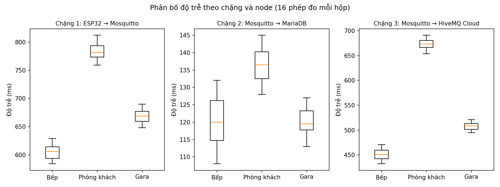
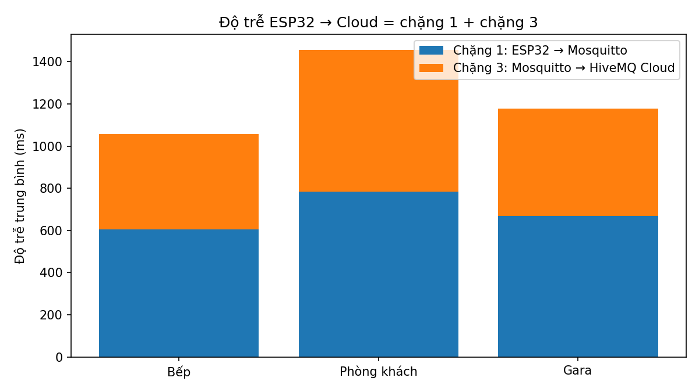

# Phân tích độ trễ truyền dữ liệu MQTT (khóa luận hệ thống cảnh báo cháy IoT)

Phân tích số liệu đo độ trễ từ Phụ lục khóa luận bằng SQL (SQLite) và Python (pandas, matplotlib).

## Câu hỏi

Độ trễ từ cảm biến ESP32 đến cloud được tạo ra chủ yếu ở chặng nào, và node nào chậm nhất?

## Dữ liệu

`do_tre_phu_luc.csv`: 144 phép đo = 3 chặng x 3 node (bếp, phòng khách, gara) x 4 lần đo x 4 loại cảm biến
(khói, gas, lửa, nhiệt độ). Số liệu lấy từ Phụ lục khóa luận (Bảng 4.8, 4.9, 4.10).

- Chặng 1: ESP32 → Mosquitto local (Raspberry Pi)
- Chặng 2: Mosquitto local → MariaDB (nhánh song song)
- Chặng 3: Mosquitto local → HiveMQ Cloud

Độ trễ ESP32 → Cloud = chặng 1 + chặng 3, vì chặng 2 chạy song song.

## Cách chạy

```bash
pip install -r requirements.txt
python analyze_latency.py
```

Kết quả nằm trong `ket_qua/`: bảng thống kê CSV và 2 biểu đồ.

## Kết quả

| Chặng | Trung bình (ms) |
|---|---|
| 1. ESP32 → Mosquitto | 686 |
| 2. Mosquitto → MariaDB | 126 |
| 3. Mosquitto → HiveMQ Cloud | 544 |

- Chặng Wi-Fi nội bộ (chặng 1) chậm nhất; ghi MariaDB (chặng 2) nhanh nhất và không gây nghẽn.
- Phòng khách chậm nhất ở cả chặng 1 (783 ms) và chặng 3 (674 ms); bếp nhanh nhất.
- Tổng ESP32 → Cloud trung bình 3 node: 1.230 ms (bếp 1.056, gara 1.177, phòng khách 1.457).
- Độ lệch chuẩn chặng 1 khoảng 12–15 ms mỗi node, nên độ trễ ổn định giữa các lần đo.




## Hạn chế

- Chỉ 3 node, 4 lần đo mỗi loại cảm biến, đo trong phòng thí nghiệm.
- Số liệu gốc chép từ Phụ lục khóa luận; chưa đo lại.
